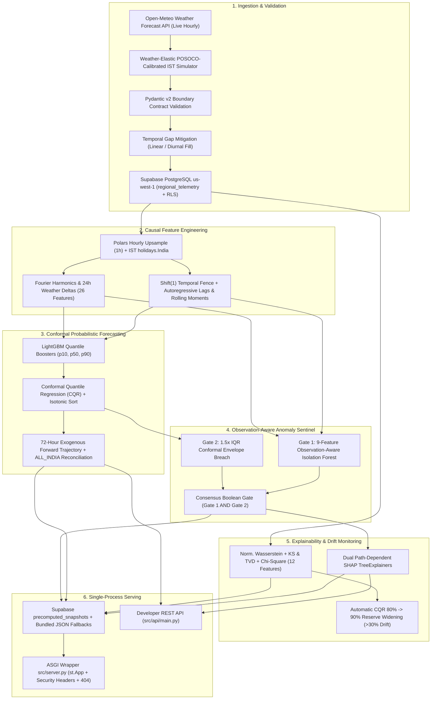

# National Power Grid Telemetry & Forecasting Engine

AI/ML platform delivering weather-elastic POSOCO-calibrated IST telemetry ingestion, 72-hour Conformal Quantile Regression (`CQR`) load forecasting, observation-aware dual-trigger anomaly detection, path-dependent `TreeSHAP` explainability, and statistical covariate drift monitoring across India's five Regional Load Despatch Centres (`RLDC`s) and the national aggregate (`ALL_INDIA`).

> **Simulation Disclosure:** Electrical demand feeds in the scheduled operational pipeline are generated by a deterministic, weather-elastic IST demand simulator calibrated to POSOCO/Grid-India Dec 2024 regional scales and driven by live Open-Meteo meteorological telemetry (non-SCADA).

---

## System Architecture

The platform runs across six decoupled subsystems with a single-process ASGI serving architecture:



---

## Regional Dispatch Coverage & Centroids

| Region | Despatch Centre | Weather Centroid (`lat, lon`) | Primary Demand Characteristics | Dec 2024 Mean Scale |
| :--- | :--- | :--- | :--- | :--- |
| **NR** | Northern RLDC | New Delhi (`28.6139, 77.2090`) | High cooling/heating sensitivity, agricultural pumping | `43,440.9 MW` |
| **WR** | Western RLDC | Mumbai (`19.0760, 72.8777`) | Heavy industrial corridor, coastal cooling humidity | `44,473.3 MW` |
| **SR** | Southern RLDC | Bengaluru (`12.9716, 77.5946`) | Dual-monsoon regimes, commercial and IT demand | `42,095.7 MW` |
| **ER** | Eastern RLDC | Kolkata (`22.5726, 88.3639`) | Mining, metallurgy, and industrial baseload | `15,251.0 MW` |
| **NER** | North Eastern RLDC | Guwahati (`26.1445, 91.7362`) | Compact peaky residential diurnal load | `2,491.6 MW` |
| **ALL_INDIA** | National LDC | Nagpur (`21.1458, 79.0882`) | Sum-reconciled national load envelope | `147,752.5 MW` |

---

## 1. Data Ingestion, Weather Elasticity & Gap Mitigation

Implemented in `src/ingestion/fetch_telemetry.py` and `src/ingestion/schemas.py`.

### Open-Meteo Telemetry Feed
- Runs on GitHub Actions every 6 hours (`cron: '15 */6 * * *'`), pulling hourly `temperature_2m`, `relative_humidity_2m`, `shortwave_radiation`, and `wind_speed_100m` across `past_days=14` (ingestion backfill) and `forecast_days=4` (exogenous rollout).
- Uses 3-attempt exponential backoff (`backoff = 2^attempt * 2.0 + U(0, 1)s`), firing `ALERT_WEBHOOK_URL` if retries are exhausted.

### POSOCO-Calibrated Weather Elasticity Equations
For each UTC timestamp converted to Indian Standard Time (`IST = UTC + 05:30`), load equals regional scale × mean-normalized 24-hour diurnal curve × weather-calendar elasticity:

```text
diurnal_factor(h) = linear_interp(NORMALIZED_DIURNAL_FACTORS, IST_hour)

cooling     = max(0, temperature_2m - 24.0) * 0.008
heating     = max(0, 15.0 - temperature_2m) * 0.004
humidity    = (max(0, relative_humidity_2m - 60.0) / 10.0) * 0.0015   if temperature_2m > 26.0 else 0
solar_btm   = max(0, surface_solar_radiation - 200.0) * 0.00004      # behind-the-meter rooftop solar offset
wind_relief = max(0, wind_speed_100m - 12.0) * 0.001
cal_adj     = -0.04 if (weekday == Sunday or date in holidays.India(IST)) else 0.0

mult      = clamp(1.0 + cooling + heating + humidity - solar_btm - wind_relief + cal_adj, 0.85, 1.20)
demand_mw = max(100.0, REGIONAL_DEMAND_BASELINES[region] * diurnal_factor * mult)
freq_hz   = round(clamp(50.0 - 0.15 * (mult - 1.0), 49.85, 50.15), 3)
```

### Schema Validation & Per-Region Gap Repair
- **Pydantic v2 (`RawGridRecord`, `RawWeatherRecord`):** Validates finite numeric values, regional capacity bounds, and UTC normalization before storage.
- **`apply_gap_mitigation`:** Processes each region in isolation sorted by timestamp:
  - **1–3 hour gaps:** Repaired via linear interpolation between adjacent observations.
  - **4–6 hour gaps:** Filled from exact `t - 24h` prior diurnal cycle within the same region (falling back to previous observation when history is shorter).
  - **> 6 hour gaps:** Left unrepaired to avoid masking upstream outages and escalates immediately to `ALERT_WEBHOOK_URL`.

---

## 2. Causal Zero-Leakage Feature Engineering (26 Features)

Implemented in `src/features/build_features.py` (`compute_telemetry_features`).

### Leakage & Aliasing Guarantees
1. **Uniform 1-Hour Grid Resampling:** Deduplicates `(region, timestamp_utc)` and runs `df.upsample(time_column="timestamp_utc", every="1h", group_by="region")` before computing any lag so missing hours can never silently shift into shorter lags. Observed rows are filtered back via `_is_observed` afterward.
2. **Asia/Kolkata Calendar Alignment:** Evaluates `hour`, `day_of_week`, `day_of_year`, and `holidays.India` statutory holidays in local `Asia/Kolkata` dates (eliminating UTC midnight shift errors).
3. **Strict `.shift(1)` Rolling Fence:** Every rolling mean and standard deviation shifts by 1 hour prior to aggregation so hour `t` regressors never read `demand_mw[t]`. Initial `168h` warm-up nulls are dropped.

### Complete 26-Feature Contract (`artifacts/feature_columns.json`)

| Feature Group | Count | Feature Columns | Computation / Alignment Rule |
| :--- | :--- | :--- | :--- |
| **Calendar & Fourier Harmonics** | 8 | `sin_hour_k1`, `cos_hour_k1`, `sin_hour_k2`, `cos_hour_k2`, `sin_doy`, `cos_doy`, `day_of_week`, `is_holiday` | `24h` & `12h` hour harmonics, `365.25d` seasonal harmonics, IST weekday & `holidays.India` |
| **Autoregressive Demand Lags** | 6 | `demand_lag_1h`, `demand_lag_2h`, `demand_lag_3h`, `demand_lag_24h`, `demand_lag_48h`, `demand_lag_168h` | Partitioned `.over("region")` on `1h`-upsampled series |
| **Causal Rolling Baselines** | 6 | `demand_rolling_mean_6h`, `demand_rolling_mean_24h`, `demand_rolling_mean_168h`, `demand_rolling_std_6h`, `demand_rolling_std_24h`, `demand_rolling_std_168h` | `pl.col("demand_mw").shift(1).rolling_*` per region |
| **Exogenous Weather & Deltas** | 6 | `temperature_2m`, `relative_humidity_2m`, `surface_solar_radiation`, `wind_speed_100m`, `temp_delta_24h`, `rh_delta_24h` | Whole-hour UTC meteorological readings + `24h` differences |

---

## 3. Conformal Forecasting, Dual-Trigger Sentinel & TreeSHAP

Implemented in `src/models/load_artifacts.py`, `src/models/infer_and_detect.py`, and `src/models/explainers.py`.

### Iterative 72-Hour Conformal Quantile Forecasting (`CQR`)
- Uses **18 LightGBM quantile boosters** (`p10`, `p50`, `p90` × 6 grids) stepped iteratively from `h = 1..72` over a `240h` aligned ring buffer (`>= 168h` required). Each predicted `p50` appends back as lag `t+1` while exogenous weather pulls from Open-Meteo `forecast_days=4` (or falls back to `t - 24h` diurnal persistence).
- Applies horizon-specific held-out residual calibration margins from `artifacts/models/quantile_calibration.json` (`horizon_margins_80` or widened `horizon_margins_90` when drift > 30%) and enforces crossing-free quantiles via isotonic sorting:

```text
p10_cal = max(0, q10_raw - margin_h)
p90_cal = q90_raw + margin_h
(p10, p50, p90) = sort([p10_cal, q50_raw, p90_cal])
```

- **Bottom-Up National Reconciliation (`reconcile_all_india_forecasts`):** Sets `ALL_INDIA` median load `p50` to `sum(NR, WR, SR, ER, NER p50)` per timestamp, shifts national `p10/p90` by `delta = p50_sum - p50_AI`, and re-sorts quantiles to conserve regional totals without sacrificing national uncertainty spread.

### 9-Feature Observation-Aware Dual-Trigger Anomaly Sentinel
Instead of triggering on stale lagged state, `_build_anomaly_feature_matrix` evaluates a **9-feature instantaneous matrix** (`artifacts/anomaly_feature_columns.json`) recomputed directly against the observed candidate demand `y_actual`:
- Dynamic demand signals: `demand_mw = y_actual`, `demand_delta_1h = y_actual - demand_lag_1h`, `demand_delta_24h = y_actual - demand_lag_24h`, `demand_zscore_24h = (y_actual - rolling_mean_24h) / max(rolling_std_24h, 1.0)`.
- Context signals: `temperature_2m`, `relative_humidity_2m`, `surface_solar_radiation`, `sin_hour_k1`, `cos_hour_k1`.

An alert fires **only on two-gate consensus**:

```text
Gate 1 (Isolation Forest): iso_forest.predict(X_anom) == -1
IQR                      = max(p90 - p10, 1e-6)
Gate 2 (1.5xIQR Bounds):   y_actual > p90 + 1.5 * IQR  OR  y_actual < max(0, p10 - 1.5 * IQR)

is_structural_anomaly    = Gate 1 AND Gate 2
```

### Dual Path-Dependent `TreeSHAP` Explainers
- **Baseline Forecast Attribution (`explain_anomaly_point`):** Exact `shap.TreeExplainer` over the 26-feature LightGBM `p50` booster reporting impacts in `MW`.
- **Anomaly Risk Attribution (`explain_anomaly_score`):** `shap.TreeExplainer` over the 9-feature Isolation Forest depth paths, sign-inverted (`-depth_shap`) so positive (`+`) attributions identify features driving the outlier score toward alert.

---

## 4. Statistical Covariate Drift Monitoring

Implemented in `src/monitoring/drift_check.py`. Compares the trailing `168h` live window against each region's `720h` December 2024 baseline Parquet file across **12 monitored covariates**:

| Covariate Type | Features Monitored | Statistical Trigger Rule |
| :--- | :--- | :--- |
| **Continuous Physical Metrics (8)** | `demand_mw`, `temperature_2m`, `relative_humidity_2m`, `surface_solar_radiation`, `wind_speed_100m`, `temp_delta_24h`, `rh_delta_24h`, `demand_rolling_std_24h` | `W1 / std >= 0.50` **AND** Kolmogorov-Smirnov `p < 0.01` |
| **Cyclical Harmonics (2)** | `sin_hour_k1`, `cos_hour_k1` | 1D Wasserstein distance `W1 >= 0.15` |
| **Discrete Calendar (2)** | `day_of_week`, `is_holiday` | Total Variation Distance `TVD >= 0.15` **AND** Chi-square `p < 0.01` |

When `drifted_features / 12 > 30%`, `drift_alarm` activates, forecast generation switches automatically from **80% CQR** (`[0.1, 0.5, 0.9]`) to **90% CQR** (`cqr_margin_90` / `[0.05, 0.5, 0.95]`), consolidated webhook alerts dispatch on transitions, and self-contained HTML reports regenerate into `static/reports/`.

---

## 5. Database Schema, Security & Serving Runtime

- **PostgreSQL Schema (`scripts/setup_database.sql`, `migrate_v2.sql`, `cleanup_retention.sql`):**
  - `regional_telemetry`: Hourly regional telemetry (`unique (region, timestamp_utc)`).
  - `model_forecasts`: Vintage-preserving multi-horizon forecasts (`unique (model_version, region, forecast_generated_at, target_timestamp_utc)`) with automated realized `actual_demand_mw` backfill.
  - `telemetry_anomalies`: Anomaly trigger results, quantile bounds, and `JSONB` TreeSHAP payloads.
  - `precomputed_snapshots`: One row per region (`JSONB` dashboard payload + standalone HTML drift report) fetched by the UI in one database round-trip (`statement_timeout = 5000ms`), with bundled JSON fallback in `artifacts/precomputed/`.
  - All four tables enforce Row-Level Security (`RLS`) and automated 90-day retention pruning (`src/ingestion/cleanup.py`).
- **Low-Memory Container & Artifact Integrity:** Lazy-loaded LightGBM boosters, Isolation Forests, Parquet baselines, and `TreeSHAP` explainers use a thread-safe `LazyDict` bounded to `max_cached_regions=2` in the UI (`gc.collect()` on eviction) to stay safely inside 512 MB containers. Isolation Forest `.joblib` artifacts verify SHA-256 digests (`hmac.compare_digest` against `artifacts/models/artifact_checksums.json`) before deserialization.
- **Single-Process ASGI Wrapper (`src/server.py`) & REST API (`src/api/main.py`):**
  - `src/server.py` mounts `streamlit.App("src/ui/app.py")`, injects SSR splash markup and `<meta name="description">`, enforces `HSTS`, `X-Content-Type-Options: nosniff`, `X-Frame-Options: SAMEORIGIN`, `Referrer-Policy`, `Permissions-Policy`, and `CSP` headers, serves `/health`, `/robots.txt`, `/favicon.ico`, and `/reports/drift_report*.html`, and returns genuine HTTP `404` HTML on unknown routes.
  - Optional developer REST API (`src/api/main.py`) exposes `/health`, `/regions`, `POST /forecast`, `POST /anomalies`, `GET /drift`, and `GET /drift/report` with per-client sliding-window rate limits, bounded inference concurrency (`BoundedSemaphore(2)`), and optional `hmac` token authentication (`API_AUTH_TOKEN` / `GRID_API_KEY`).

---

## Repository Structure

```text
grid-telemetry-engine/
|-- .github/workflows/
|   |-- ingest.yml            # SHA-pinned 6-hour ETL, inference, drift, snapshot & cleanup pipeline
|   \-- test.yml              # SHA-pinned CI compilation & pytest verification workflow
|-- .streamlit/config.toml    # Enabled CORS/XSRF protection and light theme config
|-- artifacts/
|   |-- feature_columns.json          # 26-feature LightGBM input contract
|   |-- anomaly_feature_columns.json  # 9-feature Isolation Forest input contract
|   |-- baselines/                    # 720h Dec 2024 reference baselines (.parquet)
|   |-- models/                       # 18 LightGBM boosters, 6 Isolation Forests, CQR & SHA-256 checksums
|   \-- precomputed/                  # Bundled fallback JSON snapshots per region
|-- notebooks/
|   \-- training_pipeline.ipynb       # Offline Kaggle model training & CQR calibration notebook
|-- scripts/
|   |-- setup_database.sql            # Full PostgreSQL + RLS schema definition
|   |-- migrate_v2.sql                # Additive non-destructive v2 schema migration
|   \-- cleanup_retention.sql         # 90-day storage pruning routines
|-- src/
|   |-- logging_config.py             # Shared entrypoint logging configuration
|   |-- server.py                     # Production ASGI wrapper (st.App + SSR splash + headers + 404)
|   |-- api/main.py                   # Optional developer REST service
|   |-- features/build_features.py    # Polars 1h-upsampled causal feature pipeline
|   |-- ingestion/
|   |   |-- fetch_telemetry.py        # Open-Meteo client, IST simulation & gap mitigation
|   |   |-- schemas.py                # Pydantic v2 validation contracts
|   |   \-- cleanup.py                # 90-day database retention runner
|   |-- models/
|   |   |-- explainers.py             # Path-dependent SHAP TreeExplainer & Supabase persistence
|   |   |-- infer_and_detect.py       # CQR forecasting, ALL_INDIA reconciliation, anomaly & backfill
|   |   |-- load_artifacts.py         # LRU artifact bundle & SHA-256 checksum verification
|   |   \-- precompute.py             # Live Supabase & local JSON snapshot publisher
|   |-- monitoring/drift_check.py     # Norm. Wasserstein + KS & TVD + Chi-square drift monitor
|   \-- ui/
|       |-- app.py                    # Multi-page Streamlit operational dashboard
|       |-- charts.py                 # Plotly forecast band & TreeSHAP figure builders
|       |-- components.py             # Reusable HTML KPI, notice, math & card builders
|       |-- helpers.py                # Freshness evaluation, ARIA tooltips & shared 404 template
|       \-- styles.py                 # Responsive light-mode CSS & design tokens
|-- static/                           # Favicon, robots.txt, and standalone HTML drift reports
|-- tests/                            # Unit, API, ASGI, DB integration, drift, and UI AppTest suite
|-- Dockerfile                        # Multi-stage non-root production image (python:3.12-slim)
|-- pyproject.toml                    # Package metadata, pytest pythonpath, and ruff config
|-- start.sh                          # Single-process uvicorn entrypoint for src.server:app
|-- render.yaml                       # Render Free tier blueprint (oregon)
|-- requirements.txt                  # Bounded runtime dependencies
|-- requirements-dev.txt              # Development lint, test, and audit dependencies
\-- README.md
```

---

## Local Development & Testing

```bash
python -m venv .venv
source .venv/bin/activate  # On Windows: .venv\Scripts\activate
pip install -r requirements.txt

# Run full production ASGI app locally (UI + security headers + /reports/drift_report.html)
uvicorn src.server:app --host 127.0.0.1 --port 7860 --workers 1

# Or run Streamlit directly during rapid UI iteration
streamlit run src/ui/app.py

# Regenerate bundled fallback snapshots & HTML drift reports
python -m src.models.precompute
python -m src.monitoring.drift_check

# Execute full compilation and test verification suite
python -m compileall -q src tests
pytest tests/ -v
```

---

## Live Deployment & License

- **Live Deployment:** [grid.maheshkakde.com](https://grid.maheshkakde.com)
- **License:** MIT License ([LICENSE](LICENSE)) — Mahesh Kakde ([maheshkakde.com](https://maheshkakde.com))