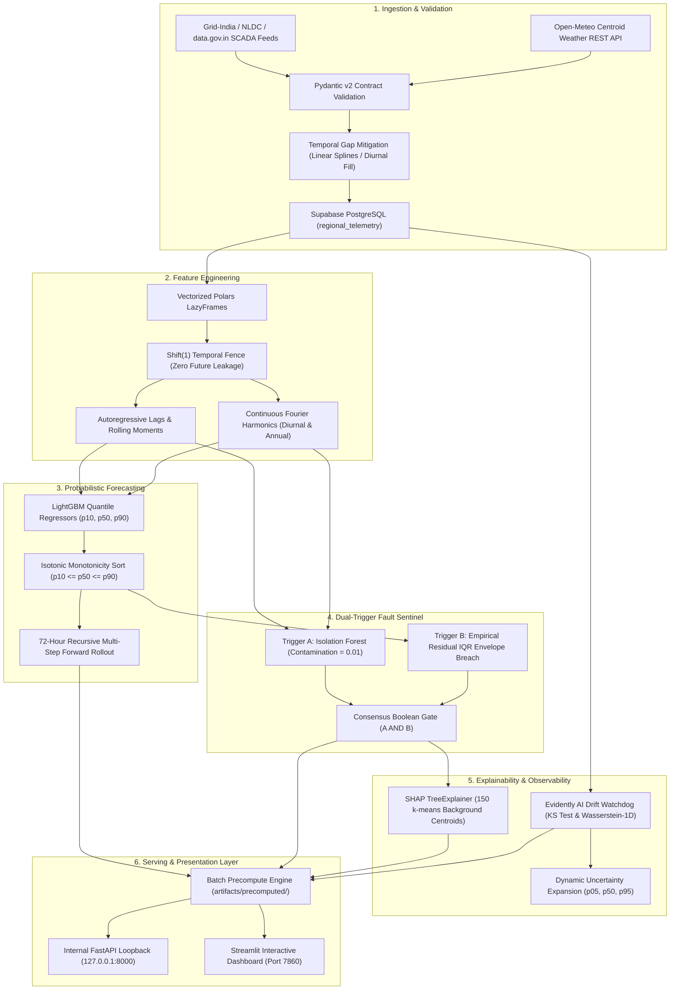

# National Power Grid Telemetry & Forecasting Engine

Production AI/ML system delivering real-time telemetry ingestion, 72-hour multi-horizon probabilistic load forecasting, dual-trigger structural anomaly detection, SHAP model explainability, and automated statistical drift monitoring for India's National Power Grid.

---

## System Architecture & Engineering Overview

The engine models active electrical load across India's 5 Regional Load Despatch Centres (RLDCs) and aggregate national demand across six decoupled subsystems:



---

## Power Grid Operating Constraints: Why Probabilistic ML?

- **The Zero-Storage Constraint:** In an alternating current (AC) power grid, active electricity generation must match demand plus transmission losses at every second ($\sum P_{\text{gen}} = \sum P_{\text{load}} + P_{\text{losses}}$). Imbalances immediately shift synchronous grid frequency away from 50.00 Hz.
- **Strict Statutory Band (49.90 Hz - 50.05 Hz):** If frequency drops below 48.80 Hz during supply deficits, under-frequency load shedding relays trip to avoid equipment damage, risking cascading regional blackouts. If frequency exceeds 50.05 Hz during excess supply, equipment faces over-excitation and burnout.
- **The Dispatcher Dilemma:** Baseload thermal power plants take 8 to 12 hours of cold startup time to bring online. Control room dispatchers cannot plan generation using a single point estimate. They need calibrated probabilistic quantile intervals ($p10, p50, p90$) to size spinning reserves economically and reliably.

---

## Regional Dispatch Coverage

The engine covers all 5 Regional Load Despatch Centres (RLDCs) and the national synchronous grid:

| Region | Despatch Centre | Primary Demand Characteristics | Baseload |
| :--- | :--- | :--- | :--- |
| **NR** | Northern RLDC (New Delhi) | High weather volatility (cooling/heating), agricultural pumping | 62,000 MW |
| **WR** | Western RLDC (Mumbai) | Heavy industrial manufacturing, high renewable penetration | 68,000 MW |
| **SR** | Southern RLDC (Bengaluru) | Dual-monsoon shifts, commercial and IT hubs, coastal humidity | 54,000 MW |
| **ER** | Eastern RLDC (Kolkata) | Heavy extractive metallurgy, steel plants, coal mining | 28,000 MW |
| **NER** | North Eastern RLDC (Shillong) | Hydro-dominated generation, high-altitude terrain | 3,500 MW |
| **ALL_INDIA** | National LDC (Grid-India, New Delhi) | Aggregate national active electrical load | 215,500 MW |

---

## Automated Ingestion & Boundary Validation

- **Automated Ingestion Cron:** Runs every 6 hours via GitHub Actions (`15 */6 * * *`), pulling regional demand and frequency telemetry calibrated against Grid-India / NLDC operational curves and open government datasets (`data.gov.in`), along with collocated hourly weather (temperature, humidity, solar irradiance, wind speed) from Open-Meteo across regional centroids.
- **Pydantic v2 Schema Enforcement:** Inbound payloads are validated against strict contracts: demand bounded between 0 and 350,000 MW, frequency bounded between 47.5 and 52.5 Hz, and all timestamps normalized to UTC ISO 8601.
- **Temporal Gap Mitigation:** Communication dropouts are handled algorithmically:
  - Short gaps ($\le 3$ hours): Monotonic linear interpolation.
  - Medium gaps (4 to 6 hours): 24-hour diurnal forward-fill from identical solar hours ($t - 24\text{h}$).
  - Critical gaps ($> 6$ hours): Automated webhook alert dispatched to `ALERT_WEBHOOK_URL`.

---

## Causal Zero-Leakage Feature Pipeline

Time-series models often suffer from future lookahead leakage when rolling statistics are computed on unshifted data. The engine uses vectorized **Polars LazyFrames** with a strict causal fence:

- **Strict Temporal Fence:** A mandatory `.shift(1)` is applied before calculating rolling means and standard deviations, ensuring time $t$ features never observe time $t$ target data.
- **Continuous Fourier Harmonics:** Eliminates artificial jump discontinuities between 23:59 and 00:00 (diurnal, $k=1$ and $k=2$) and across year boundaries (annual, $T=365.25\text{ days}$).
- **Autoregressive Lags:** Historical demand values at 1h, 2h, 3h, 24h, 48h, and 168h lags partitioned by region.
- **Rolling Moments:** Rolling means and standard deviations over 6h, 24h, and 168h windows.
- **Weather Elasticity:** 24-hour temperature and humidity deltas ($\Delta T_{24\text{h}}, \Delta RH_{24\text{h}}$) capturing rate-of-change.
- **Calendar Regimes:** Day-of-week indexing and Indian statutory national holidays via `holidays.India`.

---

## Multi-Horizon Probabilistic Quantile Forecasting

- **Pinball Loss Optimization:** Rather than predicting the conditional mean, LightGBM models are trained under asymmetric Pinball loss for quantiles $\tau \in \{0.10, 0.50, 0.90\}$:
  $$\mathcal{L}_\tau(y, \hat{y}) = \max\Big(\tau(y - \hat{y}), (\tau - 1)(y - \hat{y})\Big)$$
  For $p90$ ($\tau = 0.90$), under-predicting incurs nine times the loss of over-predicting, forcing the model to capture upper peak risk for spinning reserve allocation.
- **Isotonic Monotonicity Guarantee:** Independent quantile models can occasionally cross ($p10 > p50$). The pipeline applies post-inference sorting along axis 1:
  $$[p10^*, p50^*, p90^*] = \text{sort}([p10, p50, p90])$$
  strictly guaranteeing $p10 \le p50 \le p90$ across all 72 forecast horizons.
- **72-Hour Recursive Rollout:** The engine iteratively steps forward 72 hours, using the median ($p50$) forecast as an autoregressive surrogate for subsequent lag features.

---

## Dual-Trigger Fault Sentinel

Simple threshold alarms trigger false positives during extreme weather heatwaves. The engine requires consensus between two independent detection algorithms:

- **Trigger A (Unsupervised Pattern Isolation):** An Isolation Forest (300 trees, contamination = 0.01) evaluates the 21-dimensional feature space to flag structural anomalies.
- **Trigger B (Physical Residual IQR Envelope):** Checks whether actual demand breaches an empirical 1.5x Interquartile Range envelope:
  $$\text{Boundary} = \Big[p10 - 1.5 \cdot (p90 - p10),\; p90 + 1.5 \cdot (p90 - p10)\Big]$$
- **Consensus Gate (`Alert = Trigger A AND Trigger B`):** An alert fires only when both algorithms agree. During heatwaves, high demand is explained by weather features, suppressing false alarms. Only genuine physical grid faults breach both checks.

---

## Explainability & Drift Observability

- **SHAP TreeExplainer:** When anomalies occur, a path-dependent SHAP TreeExplainer with 150 k-means background centroids computes exact additive Megawatt contributions per feature, surfacing the top-3 physical drivers to operators.
- **Continuous Statistical Drift Monitoring:** Every 6 hours, trailing 7-day operational telemetry is tested against a 30-day reference baseline:
  - Two-Sample Kolmogorov-Smirnov test ($p < 0.05$) for continuous telemetry (load, frequency, temperature, humidity, solar, wind).
  - 1D Wasserstein Earth Mover's Distance ($W_1 \ge 0.10$) for cyclical Fourier harmonics and calendar features.
- **Dynamic Uncertainty Adaptation:** If more than 30% of features drift, the engine recommends retraining and dynamically expands forecast bounds from $[p10, p50, p90]$ to $[p05, p50, p95]$ for reserve safety.
- **Standalone Diagnostic Reports:** Automatically outputs visual, self-contained HTML reports to `static/reports/drift_report.html`.

---

## Production Deployment & Container Architecture

- **Co-Located Container Services:** Packaged in a multi-stage Docker container (`python:3.11-slim`) where `start.sh` supervises an internal FastAPI service on loopback (`127.0.0.1:8000`) and the interactive Streamlit UI on external `$PORT` (7860/10000).
- **Batch ML Precomputation:** Heavy 72-hour recursive forecasts, nominal SHAP attributions, and drift metrics are precomputed during the 6-hour cron and stored as JSON snapshots in `artifacts/precomputed/`. This drops dashboard cold-load latency to under 50ms and reduces memory requirements from ~500 MB to ~60 MB.
- **Database & Automated 90-Day Retention:** Telemetry and forecast vectors are upserted into Supabase PostgreSQL. A scheduled cleanup script prunes records older than 90 days, bounding storage to under 13,000 rows (<2.6 MB).

---

## Repository Structure

```
grid-telemetry-engine/
|-- .github/workflows/
|   |-- ingest.yml            # 6-hour cron (ETL, inference, drift monitoring, precompute)
|   \-- test.yml              # Automated CI test verification workflow
|-- .streamlit/config.toml    # Streamlit theme and UI configuration
|-- artifacts/                # Pretrained models, reference baselines, and feature contracts
|   |-- feature_columns.json  # 21-feature contract specification
|   |-- baselines/            # 30-day reference baselines and SHAP background clusters
|   |-- models/               # 18 LightGBM quantile trees and 6 Isolation Forests
|   \-- precomputed/          # Regional JSON snapshots for instant dashboard serving
|-- notebooks/
|   \-- training_pipeline.ipynb # Offline model training and evaluation notebook
|-- scripts/
|   |-- setup_database.sql    # Relational PostgreSQL table schemas and indices
|   \-- cleanup_retention.sql # 90-day storage pruning routines
|-- src/
|   |-- api/main.py           # Internal FastAPI loopback service
|   |-- features/build_features.py # Polars zero-leakage causal feature pipeline
|   |-- ingestion/
|   |   |-- fetch_telemetry.py # Ingestion client, backoff circuit breaker, gap filler
|   |   |-- schemas.py        # Pydantic v2 physical boundary validation contracts
|   |   \-- cleanup.py        # Automated 90-day retention execution harness
|   |-- models/
|   |   |-- explainers.py     # SHAP TreeExplainer feature attribution engine
|   |   |-- infer_and_detect.py # Quantile forecaster and dual-trigger sentinel
|   |   |-- load_artifacts.py # In-memory artifact loader and bundle cache
|   |   \-- precompute.py     # Batch snapshot generator for low-latency serving
|   |-- monitoring/drift_check.py # Evidently AI KS and Wasserstein drift engine
|   \-- ui/app.py             # Streamlit operational dashboard
|-- static/
|   |-- favicon.png           # Custom SVG/PNG favicon
|   |-- robots.txt            # Search engine crawler policies
|   \-- reports/drift_report.html # Standalone HTML drift diagnostic report
|-- tests/                    # Automated pytest suite (34 tests)
|-- Dockerfile                # Multi-stage production container
|-- start.sh                  # Dual-process supervisor script
|-- render.yaml               # Infrastructure-as-code deployment blueprint
|-- requirements.txt          # Pinned production dependencies
|-- LICENSE                   # MIT License
\-- README.md
```

---

## Local Development & Testing

### Environment Setup
```bash
# Clone the repository
git clone https://github.com/mahesh-kakde/grid-telemetry-engine.git
cd grid-telemetry-engine

# Initialize Python virtual environment
python -m venv .venv
source .venv/bin/activate  # On Windows: .venv\Scripts\activate

# Install pinned dependencies
pip install -r requirements.txt
```

### Running the Application
```bash
# Run the Streamlit dashboard directly (in-memory mode)
streamlit run src/ui/app.py

# Run the internal FastAPI backend standalone
python -m uvicorn src.api.main:app --host 127.0.0.1 --port 8000 --reload

# Regenerate precomputed inference snapshots
python -m src.models.precompute
```

### Executing the Automated Test Suite
```bash
pytest tests/ -v
```

---

## Container Execution

```bash
# Build the production Docker image
docker build -t grid-telemetry-engine .

# Run container locally on port 7860
docker run -p 7860:7860 grid-telemetry-engine
```

---

## Live Deployment

The system is deployed live and publicly accessible at:

[grid.maheshkakde.com](https://grid.maheshkakde.com)

---

## License

This project is licensed under the MIT License - see the [LICENSE](LICENSE) file for details.

Copyright (c) 2026 Mahesh Kakde.

---

## Author

[Mahesh Kakde](https://maheshkakde.com)